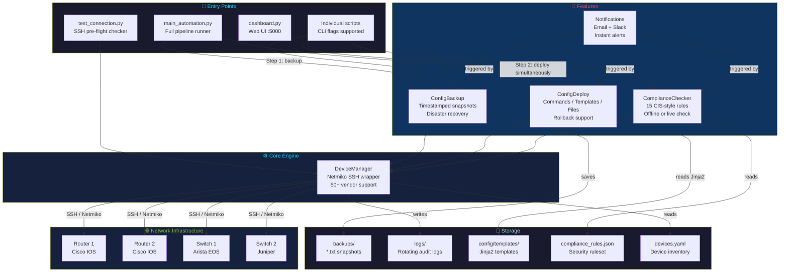

<div align="center">


<br/>

[](https://python.org)
[](https://github.com/ktbyers/netmiko)
[](https://flask.palletsprojects.com)
[](tests/)
[](LICENSE)

<br/>

**A Python framework that acts as an automated network administrator.**
**SSH into every router and switch. Back up configs. Push changes — to all devices simultaneously.**

<br/>

[](https://www.cisco.com)
[](https://www.cisco.com)
[](https://www.juniper.net)
[](https://www.arista.com)
[](https://github.com/ktbyers/netmiko#supports)

</div>

---

## ⚡ What This Does in 30 Seconds

```bash
python main_automation.py
```

```
╔══════════════════════════════════════════════════════════╗
║        Network Automation & Provisioning                 ║
╠══════════════════════════════════════════════════════════╣
║  Devices  : 10 routers + switches loaded                 ║
╚══════════════════════════════════════════════════════════╝

[STEP 1] Backing up all device configs (pre-change snapshot)
  ✅ 192.168.1.1  →  backups/192.168.1.1_20261106_173000.txt
  ✅ 192.168.1.2  →  backups/192.168.1.2_20261106_173001.txt
  ✅ 192.168.1.3  →  backups/192.168.1.3_20261106_173001.txt
  Backup complete: 10/10 successful

[STEP 2] Deploying guest network (VLAN 100) — ALL DEVICES SIMULTANEOUSLY
  ✅ 192.168.1.1  —  3.2s        ✅ 192.168.1.6  —  3.5s
  ✅ 192.168.1.2  —  3.1s        ✅ 192.168.1.7  —  3.8s
  ✅ 192.168.1.3  —  3.4s        ✅ 192.168.1.8  —  3.3s
  Provisioning complete: 10/10  ⏱ Total time: 3.8s (not 38s)

  Logs saved → logs/network_automation.log
```

> Without automation: 10 devices × 5 min each = **50 minutes of manual work.**
> With this framework: **under 4 seconds — simultaneously.**

---

## 🗂️ Project Structure

```
📦 Network-Automation-and-Provisioning
 ┃
 ┣ 🚀 main_automation.py          ← START HERE — runs the full pipeline
 ┣ 🔌 test_connection.py          ← SSH pre-flight checker
 ┃
 ┣ 📁 scripts/
 ┃   ┣ 🔗 device_manager.py       ← SSH engine (wraps Netmiko)
 ┃   ┣ 💾 config_backup.py        ← pulls & saves running configs
 ┃   ┣ 🚀 config_deploy.py        ← pushes commands / templates / files
 ┃   ┣ ✅ config_compliance.py     ← audits configs against security rules
 ┃   ┣ 🔔 notifications.py        ← email & Slack alerts
 ┃   ┗ 🌐 dashboard.py            ← Flask web UI (localhost:5000)
 ┃
 ┣ 📁 config/
 ┃   ┣ 📋 devices.yaml            ← your device inventory (IPs, creds)
 ┃   ┣ 🔒 compliance_rules.json   ← 15 CIS-style security rules
 ┃   ┣ 🔔 notifications.json      ← email/Slack config
 ┃   ┗ 📁 templates/
 ┃       ┣ 🌐 guest_network.j2    ← guest WiFi VLAN template
 ┃       ┗ 🔌 interface_config.j2 ← interface config template
 ┃
 ┣ 📁 backups/                    ← timestamped config snapshots
 ┣ 📁 logs/                       ← rotating audit logs
 ┣ 📁 templates/                  ← Flask web dashboard HTML
 ┣ 📁 tests/                      ← 31 unit tests (all passing ✅)
 ┃
 ┣ 📖 LEARNING_GUIDE.md           ← plain-English explanation of everything
 ┣ 📖 QUICKSTART.md               ← up and running in 5 minutes
 ┗ 📖 GNS3_SETUP.md               ← lab setup guide
```

---

## 🏗️ Architecture



---

## ✨ Features

<table>
<tr>
<td width="50%">

### 💾 Automated Config Backup
Connects to every device via SSH, runs `show running-config`, and saves timestamped snapshots — your disaster recovery insurance.

```
backups/
  192.168.1.1_20261106_090000.txt
  192.168.1.1_20261106_210000.txt
  192.168.1.2_20261106_090000.txt
```

</td>
<td width="50%">

### 🚀 Simultaneous Mass Provisioning
Push configs to **all devices at the same time** using `ThreadPoolExecutor`. 10 devices in 4 seconds, not 40.

```python
# All SSH sessions open in parallel
with ThreadPoolExecutor(max_workers=len(devices)) as ex:
    futures = [ex.submit(deploy, dev) for dev in devices]
```

</td>
</tr>
<tr>
<td width="50%">

### 🌐 Guest Network Deployment
One command deploys a complete guest WiFi VLAN — DHCP pool, gateway SVI, and an isolation ACL — across your entire network.

```bash
python main_automation.py --vlan 100
```

</td>
<td width="50%">

### ✅ Security Compliance Checker
Audits device configs against **15 CIS-style rules** (NTP, SSH v2, no Telnet, AAA, SNMP v3...) from backup files — no live connection needed.

```
192.168.1.1  →  93% compliant  (14/15 rules)
192.168.1.2  →  87% compliant  (13/15 rules)
```

</td>
</tr>
<tr>
<td width="50%">

### 🔔 Email & Slack Notifications
Instant alerts when backups, deployments, or compliance checks finish — with per-device status and failure details.

</td>
<td width="50%">

### 🌐 Web Dashboard
Flask-powered UI at `http://localhost:5000` — view devices, trigger backups, run compliance checks, and stream live logs.

```bash
python scripts/dashboard.py
```

</td>
</tr>
</table>

---

## 🚀 Quick Start

### 1 — Install Dependencies
```bash
git clone https://github.com/RathinRH/Network-Automation-and-Provisioning.git
cd Network-Automation-and-Provisioning
pip install -r requirements.txt
```

### 2 — Add Your Devices
Edit `config/devices.yaml`:
```yaml
devices:
  - device_type: cisco_ios
    host: 192.168.1.1        # your router IP
    username: admin
    password: your_password
    secret: enable_password  # optional
    port: 22
```

### 3 — Verify SSH Connectivity
```bash
python test_connection.py
```
```
✅  192.168.1.1  (1.4s)   Cisco IOS Software, Version 15.6...
✅  192.168.1.2  (1.6s)   Cisco IOS Software, Version 15.6...

Result: 2/2 devices reachable
✅  All good — you can run:  python main_automation.py
```

### 4 — Run the Full Automation
```bash
# Full run: backup all → deploy guest network simultaneously
python main_automation.py

# Deploy a custom VLAN
python main_automation.py --vlan 200

# Test without touching devices
python main_automation.py --dry-run

# Backup only
python main_automation.py --skip-deploy
```

---

## 🛠️ All CLI Commands

```bash
# ── Main pipeline ───────────────────────────────────────────
python main_automation.py                      # full run
python main_automation.py --dry-run            # simulate (no SSH)
python main_automation.py --vlan 200           # custom VLAN
python main_automation.py --skip-backup        # deploy only
python main_automation.py --skip-deploy        # backup only

# ── Individual scripts ──────────────────────────────────────
python scripts/config_backup.py                # backup all devices
python scripts/config_deploy.py --host 192.168.1.1 --commands "ntp server 10.0.0.1"
python scripts/config_deploy.py --template guest_network.j2 --vars '{...}'
python scripts/config_compliance.py            # check from backups
python scripts/config_compliance.py --live     # check live devices

# ── Dashboard & tests ───────────────────────────────────────
python scripts/dashboard.py                    # web UI → localhost:5000
python test_connection.py                      # SSH pre-flight check
python -m pytest tests/ -v                     # run 31 unit tests
```

---

## 🔒 Compliance Rules (15 CIS-Style Checks)

| # | Rule | Type |
|---|---|---|
| 1 | NTP Server Configured | `must_contain` |
| 2 | SSH Version 2 Only | `regex` |
| 3 | No Telnet Access | `must_not_contain` |
| 4 | Logging Server Configured | `must_contain` |
| 5 | No Default SNMP Community | `must_not_contain` |
| 6 | AAA Authentication Enabled | `must_contain` |
| 7 | Enable Secret (not Password) | `must_contain` |
| 8 | No Weak Enable Password | `must_not_contain` |
| 9 | Service Password Encryption | `must_contain` |
| 10 | Login Banner Configured | `must_contain` |
| 11 | VTY Access Control List | `regex` |
| 12 | Console Timeout Set | `regex` |
| 13 | SNMP Version 3 | `must_contain` |
| 14 | CDP Disabled | `must_contain` |
| 15 | Spanning Tree PortFast | `regex` |

Add your own rules in `config/compliance_rules.json` using `must_contain`, `must_not_contain`, `regex`, or `command` types.

---

## 📦 Tech Stack

| Technology | Version | Purpose |
|---|---|---|
| **Python** | 3.7+ | Core language |
| **Netmiko** | 4.1+ | Multi-vendor SSH automation (50+ devices) |
| **Paramiko** | 3.0+ | SSH transport layer |
| **PyYAML** | 6.0+ | Device inventory parsing |
| **Jinja2** | 3.1+ | Configuration templating |
| **Flask** | 3.0+ | Web dashboard & REST API |
| **Requests** | 2.31+ | Slack webhook HTTP client |
| **pytest** | 9.0+ | 31 unit tests with mocks |
| **ThreadPoolExecutor** | stdlib | Parallel simultaneous provisioning |

---

## 🧪 Tests

```bash
python -m pytest tests/ -v
```

```
31 passed in 0.69s

TestDeviceManager       ✅ 11 tests  — connect, disconnect, send_command, send_config
TestConfigBackup        ✅  4 tests  — backup creation, failure handling, file naming
TestConfigDeploy        ✅  4 tests  — commands, templates, files, rollback
TestComplianceRule      ✅  7 tests  — all 4 rule types
TestComplianceChecker   ✅  5 tests  — load rules, check device, generate report
```

All tests use **mocks** — no real network devices needed to run them.

---

## 🔐 Security

- `config/devices.yaml` and `config/notifications.json` are in `.gitignore` — **never committed**
- Use **environment variables** for production credentials: `os.environ.get('DEVICE_PASSWORD')`
- Dashboard `SECRET_KEY` reads from `SECRET_KEY` env var
- Path traversal protection on backup file downloads
- Compliance checker enforces security best practices on your devices

---

## 📖 Documentation

| File | Contents |
|---|---|
| [LEARNING_GUIDE.md](LEARNING_GUIDE.md) | Plain-English explanation of every file, every concept, interview talking points |
| [QUICKSTART.md](QUICKSTART.md) | Up and running in 5 minutes |
| [GNS3_SETUP.md](GNS3_SETUP.md) | Full lab setup guide (GNS3 + IOS SSH config) |
| [NEW_FEATURES.md](NEW_FEATURES.md) | Dashboard, compliance, notifications deep-dive |

---

## 🗺️ Roadmap

- [x] Multi-vendor SSH via Netmiko
- [x] Automated timestamped backups
- [x] Jinja2 config templates
- [x] Simultaneous parallel provisioning
- [x] Guest network deployment template
- [x] CIS-style compliance checker (15 rules)
- [x] Email & Slack notifications
- [x] Flask web dashboard + REST API
- [x] 31 unit tests
- [ ] Git-based config version control (diff viewer)
- [ ] Scheduled backups (cron / Windows Task Scheduler)
- [ ] Ansible integration
- [ ] Prometheus metrics endpoint

---

## 🤝 Contributing

Pull requests welcome! To contribute:

```bash
# 1. Fork on GitHub → https://github.com/RathinRH/Network-Automation-and-Provisioning
# 2. Clone your fork
git clone https://github.com/YOUR_USERNAME/Network-Automation-and-Provisioning.git
git checkout -b feature/your-feature
git commit -m "Add your feature"
git push origin feature/your-feature
# 3. Open a Pull Request on GitHub
```

---

## 📄 License

MIT © [Rathindra](https://github.com/RathinRH)

---

<div align="center">

**Built with Python 🐍 | Powered by Netmiko 🔌 | Made for Network Engineers 🌐**

⭐ Star this repo if it helped you understand network automation!

</div>
